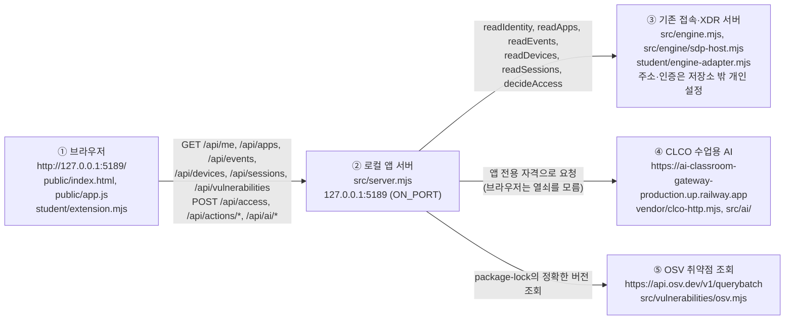

# 금오산 학생용 실행 설명서

이 문서는 학생이 새로 쓴 문서입니다. 제공 문서(`README.md`, `docs/STUDENT_LAUNCH_GUIDE.md` 등)는 고치지 않았고, 이 문서가 그 내용을 대신하지도 않습니다.

- **금오산**: 이 저장소의 `on-client/` 폴더에서 실행하는 보안 Agent 앱입니다. 화면 제목과 실행 도구의 안내 문구에는 시작 틀의 기본 이름 「케셰브」가 나올 수 있습니다.
- **상태 표기**: 이 문서의 모든 항목은 아래 여섯 가지 중 하나로 표시합니다. 표시가 없는 명령은 쓰지 않았습니다.

| 표기 | 뜻 |
| --- | --- |
| 실행함 | 작성자가 이 PC에서 직접 실행해 결과를 본 것 |
| 코드만 읽음 | 파일의 코드·문서를 읽었지만 실행하지 않은 것 |
| 학생 화면 캡처로 확인 | 학생이 보낸 화면 캡처에서 읽은 것. 캡처에 보이지 않는 부분은 확인한 것으로 보지 않음 |
| 예제 자료 화면 캡처로 확인 | `-Demo`로 실행한 화면의 학생 캡처에서 읽은 것. 예제 자료이며 실제 연결의 확인이 아님 |
| 학생 확인 대기 | 학생이 새 PowerShell 창에서 따라 해 본 뒤 결과를 알려 주면 바꿀 항목 |
| 확인 필요 | 실행하지 않았고 근거 문서도 확정하지 않은 것 |

> 구성: 1 필요 프로그램, 2 폴더 구조, 3 실행, 4 종료·재실행, 5 시스템 구성도, 6 구현 함수, 7 제공 코드 경계, 8 오류별 확인 순서, 9 확인하지 못한 기능. 아직 확인하지 못한 항목은 9장에 모았습니다.

## 1. 필요한 프로그램과 확인한 버전

| 프로그램 | 요구 | 이 PC에서 확인한 버전 | 상태 |
| --- | --- | --- | --- |
| Windows PowerShell | 실행 도구 `tools/start-alekov.ps1`을 쓰는 데 필요 | Windows 11 Pro 10.0.26200에서 사용 | 코드만 읽음 |
| Node.js | 실행 도구는 22~24 버전만 허용, 수업 기준은 `v24.19.0`(`package.json`의 `engines`) | `v24.18.1` | 실행함(`node --version`) |
| npm | `npm start` 등 대체 실행에만 필요 | `11.16.0` | 실행함(`npm --version`) |
| Git | 커밋과 제출 준비에 필요 | `2.55.0.windows.3` | 실행함(`git --version`) |

- 이 PC의 Node.js `v24.18.1`은 수업 기준 `v24.19.0`과 다릅니다. 실행 도구는 다른 버전이어도 「참고: 지금 Node.js 는 … 입니다. 수업 기준은 v24.19.0 입니다.」만 보여 주고 실행을 막지 않습니다(`tools/start-alekov.ps1` 93행, 코드만 읽음). 이 PC에서 앱이 `v24.18.1`로 실제로 뜬 것은 학생 PowerShell 창과 화면 캡처로 확인했습니다(3장).
- 외부 npm 의존성이 없어 `npm install`이 필요 없습니다(`on-client/package.json`에 `dependencies`가 없음, 코드만 읽음). 저장소 루트의 `package.json`은 1~12단계 방어전 앱의 것이며 이 앱과 별개입니다.
- 지원하지 않는 환경: Node.js 21 이하·25 이상은 실행 도구가 막습니다(코드만 읽음). macOS·Linux에서 실행하는 방법은 확인하지 않았습니다(확인 필요).

## 2. 폴더 구조

Git 저장소의 최상위는 저장소 루트이고, 앱 폴더는 그 안의 `on-client/`입니다. 아래는 `on-client/` 안에서 이 앱이 쓰는 위치입니다(`git ls-files`와 폴더 목록을 대조함, 실행함).

| 위치 | 역할 | 구분 |
| --- | --- | --- |
| `student/extension.mjs` | 학생 화면 함수 8개(`createStudentView()`가 반환) | **학생 작성** |
| `student/engine-adapter.mjs` | 기존 서버 연결 어댑터. 기본값은 연결 없음(`evidenceMode: 'disconnected'`) | 제공 |
| `public/` (`index.html`, `app.js`, `style.css`, `ai-connect.mjs`, `vulnerabilities-view.mjs`, `assets/`) | 브라우저가 받는 제공 화면 | 제공 |
| `src/server.mjs` | 로컬 앱 서버. `127.0.0.1`의 포트 `5189`(기본)만 연결 | 제공 |
| `src/engine.mjs`, `src/engine/` | 기존 접속·XDR 서버 연결(예제 엔진 `demoEngine` 포함) | 제공 |
| `src/ai/`, `src/connection/`, `src/actions/`, `src/learner-support/`, `src/vulnerabilities/` | AI 연결, 계정 연결, 조치, 도움정보, 취약점 조회 | 제공 |
| `tools/start-alekov.ps1` | 실행 도구 | 제공 |
| `docs/` | 제공 안내 문서. 이 문서(`STUDENT_RUNBOOK.md`)만 학생이 추가 | 제공 + 학생 1개 |
| `.on-starter-manifest.json` | 제공 파일 목록과 해시 | 제공 |

- 실제 `.env`는 저장소에 없습니다. 시작 틀의 `.env.example`은 루트 `.gitignore`의 `.env.*` 규칙 때문에 커밋되지 않았습니다(`git check-ignore`로 확인, 실행함). 비밀값을 파일로 만들어 넣을 필요가 없고, 이 문서도 비밀값을 적지 않습니다.

## 3. 실행

**PowerShell을 여는 위치**: 파일 탐색기에서 `on-client` 폴더를 열고, 주소 표시줄에 `powershell`을 입력한 뒤 Enter를 누릅니다. 프롬프트가 `…\choi-bujang-secret-vault\on-client>`로 끝나는지 확인합니다(코드만 읽음: 실행 도구는 자기 위치의 상위 폴더를 앱 폴더로 봅니다).

**실행 명령 (기본)**

```powershell
powershell -NoProfile -ExecutionPolicy Bypass -File .\tools\start-alekov.ps1
```

| 항목 | 내용 | 상태 |
| --- | --- | --- |
| 정상 시작 신호 | 창에 아래 줄이 차례로 나오고, 마지막 줄에서 커서가 멈춘 채 창이 열려 있음(서버가 실행 중이라는 뜻).<br>① `참고: 지금 Node.js 는 v24.18.1 입니다. 수업 기준은 v24.19.0 입니다.` (Node.js가 `v24.19.0`이 아닐 때만)<br>② `케셰브 연결 확인: http://127.0.0.1:5189` (서버가 직접 출력)<br>③ `케셰브가 켜졌습니다. 브라우저에서 http://127.0.0.1:5189/ 을 여세요.`<br>④ `서버가 응답한 것만 확인했습니다. AI 연결 상태는 화면에서 따로 확인해 주세요.`<br>⑤ `끄려면 이 창에서 Ctrl+C 를 누르세요.` | 학생 PowerShell 창 캡처로 확인(2026-10-27, Node.js `v24.18.1`) |
| 브라우저 주소 | `http://127.0.0.1:5189/` | 학생 PowerShell 창 캡처(②·③번 줄)와 학생 브라우저 캡처(주소 표시줄 `127.0.0.1:5189`)로 확인 |
| 화면 신호 | 왼쪽 메뉴 세 개 「보호 현황」「업무 앱」「보안 기록」이 보이고 「보호 현황」이 먼저 열림. 기본 실행에서는 위쪽 상태 표시가 「연결 없음」이고, 「현재 로그인」은 `확인 불가 (요청 실패)`, 학생 구현 표시(`student/extension.mjs · renderIdentity`)는 `연결 방식: 연결 없음`과 `연결 실패: 기존 서버·에이전트의 연결을 확인할 수 없습니다. 연결 어댑터를 먼저 확인하세요. (현재 값은 확인 불가)`를 보여 줌 | 학생 화면 캡처로 확인(2026-10-27 11:30:14, 11:48:17 확인 시각, 보호 현황 화면). 이 캡처에는 주소 표시줄과 PowerShell 창이 없고, 시작 신호와 주소는 위 두 행의 별도 캡처로 확인함 |
| `-ExecutionPolicy Bypass` | 이 한 번의 실행에만 적용되고 PC 설정은 바뀌지 않음 | 제공 안내를 인용(`docs/STUDENT_LAUNCH_GUIDE.md` 40행). 이 명령으로 앱이 뜬 것은 학생 PowerShell 창 캡처로 확인함. PC 설정이 바뀌지 않는다는 점은 확인하지 않고 제공 안내를 따름. 작성자(코딩 도구)가 이 명령을 실행하는 시도는 자동 모드에서 거부되어 실행하지 못함 |

**실행 모드 (같은 명령 끝에 붙임)**

| 하려는 일 | 명령 끝에 붙일 것 | 주의 |
| --- | --- | --- |
| 다른 포트로 실행 | ` -Port 5190` (브라우저 주소도 `:5190`) | 포트 5189를 다른 프로그램이 쓰면 실행 도구가 멈추고 이 방법을 안내함. 다른 프로그램은 끄지 않음 |
| 창 없이 실행 | ` -Background` | 시작할 때 안내된 「프로세스 번호」와 같은 번호의 `node.exe`를 작업 관리자(`Ctrl+Shift+Esc`)의 「세부 정보」 탭에서 PID 열로 찾아 「작업 끝내기」로 종료해야 꺼짐. 번호가 다른 `node.exe`는 다른 프로그램이 쓰는 것일 수 있으므로 종료하지 않음 |
| 예제 자료로 화면 확인 | ` -Demo` | 예제 자료이며 **실제 연결 성공이 아님**. 판정은 고정값(`library`=허용, `repository`=거부, 그 외=추가 확인) |

`-Demo`는 학생이 실행해 화면을 확인했습니다(2026-10-27 12:06:33 확인 시각 캡처에 위쪽 상태 표시 「예제 데이터(demo) · 실제 연결 아님」). `-Port 5190`은 학생이 실행해 브라우저 주소 `127.0.0.1:5190`에서 「연결 없음」 상태의 앱이 열리는 것을 캡처로 확인했습니다(2026-10-27 12:30:48 확인 시각, 12:31:49 확인 시각의 캡처도 같은 5190 창이라고 학생이 확인해 줌). 5189 포트가 이미 쓰이는 상태에서 같은 명령을 다시 실행하면 PowerShell 창에 `참고: 지금 Node.js 는 v24.18.1 입니다. …`에 이어 `포트 5189 를 다른 프로그램이 쓰고 있습니다. 그 프로그램은 그대로 두고, 다른 번호로 실행해 주세요. 예: -Port 5190`이 나오는 것도 학생 PowerShell 창 캡처로 확인했습니다. `-Port 5190`으로 켰을 때의 PowerShell 창 출력은 캡처로 확인하지 못했습니다. `-Background`는 학생이 안내에 따라 실행해, 앱이 열린 것(2026-10-27 12:36:07 확인 시각 캡처), 작업 관리자의 「세부 정보」 탭에서 PID로 `node`를 찾을 수 있었던 것(학생이 글로 확인), 종료 뒤 `127.0.0.1:5189`가 `ERR_CONNECTION_REFUSED`인 것(캡처)을 확인했습니다. 명령을 실행한 직후 PowerShell 창에 세 줄이 나오고 프롬프트가 바로 돌아오는지는 캡처로 확인하지 못했습니다(코드만 읽음, `tools/start-alekov.ps1` 135~138행).

`-Demo`로 켰을 때의 PowerShell 창 출력도 학생 캡처로 확인했습니다(2026-10-27, 같은 실행의 화면 확인 시각 오후 1:55:26). 차례로 `참고: 지금 Node.js 는 v24.18.1 입니다. 수업 기준은 v24.19.0 입니다.`, `케셰브 예제: http://127.0.0.1:5189`, `케셰브가 켜졌습니다. 브라우저에서 http://127.0.0.1:5189/ 을 여세요.`, `서버가 응답한 것만 확인했습니다. AI 연결 상태는 화면에서 따로 확인해 주세요.`, `끄려면 이 창에서 Ctrl+C 를 누르세요.`가 나왔습니다. 기본 실행과 달리 서버가 직접 출력하는 줄이 `케셰브 연결 확인:`이 아니라 `케셰브 예제:`입니다.

**실행 도구를 못 쓸 때의 대체 실행**: 같은 폴더에서 `npm start`는 `node src/server.mjs`와 같고 같은 주소 `http://127.0.0.1:5189/`를 씁니다(`on-client/package.json`, 코드만 읽음). 이 경우 창에는 서버가 직접 출력하는 `케셰브 연결 확인: http://127.0.0.1:5189` 한 줄만 나올 것으로 보입니다(`src/server.mjs` 744행. 실행 도구를 쓸 때는 이 줄도 함께 나오는 것을 캡처로 확인했습니다). 실행 도구와 달리 Node.js 버전과 포트를 미리 확인하지 않으므로 오류 원인은 8장에서 찾습니다. `npm start`는 학생이 안내에 따라 실행해, 브라우저 주소 `127.0.0.1:5189`에서 「연결 없음」 상태의 앱이 열리는 것(2026-10-27 12:41:12 확인 시각 캡처)과 끈 뒤 `ERR_CONNECTION_REFUSED`가 나오는 것(캡처)을 확인했습니다. 이때 PowerShell 창에 위의 한 줄만 나오는지는 캡처로 확인하지 못했습니다. `npm run demo`(`node src/server.mjs --demo`와 같음, `on-client/package.json` 8행)는 학생이 터미널에서 실행해, `> alekov-client-starter@0.2.11 demo`, `> node src/server.mjs --demo`(npm이 붙이는 두 줄)에 이어 `케셰브 예제: http://127.0.0.1:5189`이 나오는 것과 브라우저 위쪽에 「예제 데이터(demo) · 실제 연결 아님」이 뜨는 것을 캡처로 확인했습니다(2026-10-27, 화면 확인 시각 오후 2:05:20). 실행 도구를 거치지 않으므로 「케셰브가 켜졌습니다」 안내는 나오지 않았습니다.

**문법만 확인**: `npm run check`는 `node --check student/extension.mjs`를 실행합니다. 서버를 켜지 않고 학생 파일의 문법만 봅니다. 같은 확인을 `on-client` 폴더에서 `node --check student/extension.mjs`로 실행했고 오류 없이 끝났습니다(실행함). 이것은 화면이 맞게 동작한다는 뜻이 아닙니다.

**패키지 조회 대상 연결 (확인용, 선택)**: 「설치 패키지 조회」는 서버가 조회할 프로젝트 폴더를 알아야 결과를 냅니다. 그 폴더는 환경변수 `ON_PROJECT_DIRECTORY`(절대 경로)로 서버에 알려 주며(`src/server.mjs` 738행), 값은 그 PowerShell 창에서만 쓰이고 창을 닫으면 사라집니다. 학생이 아래 순서로 `npm start`(실행 도구가 아님)와 함께 실행해, 폴더에 따라 화면이 달라지는 것을 캡처로 확인했습니다(2026-10-27).

```powershell
$env:ON_PROJECT_DIRECTORY = (Get-Location).Path   # 또는 (Resolve-Path ..).Path
npm start
# 끝난 뒤 값 지우기
Remove-Item Env:ON_PROJECT_DIRECTORY
```

| 서버에 알려 준 폴더 | 「설치 패키지 조회」를 누른 뒤 학생 표시 | 제공 카드의 코드 | 상태 |
| --- | --- | --- | --- |
| 알려 주지 않음(기본 실행) | `주의: 조회 준비 미완료(not_configured)` | `PROJECT_NOT_CONFIGURED` | 학생 캡처로 확인 |
| `package-lock.json`이 없는 `on-client` 폴더 | `주의: lock 파일 확인 불가(unverifiable)`, 「설치 목록(package-lock.json)을 확인하지 못해 조회하지 않았습니다. 취약점이 없다는 뜻이 아닙니다.」 | `LOCKFILE_UNVERIFIABLE` | 학생 캡처로 확인 |
| `package-lock.json`이 있는 저장소 루트 폴더 | `주의: 아직 조회 안 함(not_checked)`, 「승인된 공개 조회 대상이 없어 조회하지 않았습니다. 취약점이 없다는 뜻이 아닙니다.」 | `NO_APPROVED_PACKAGES` | 학생 캡처로 확인 |

- 세 경우 모두 「연결 방식: 연결 없음」이고, 제공 카드의 `출처 https://api.osv.dev/v1/querybatch`는 이름표입니다. 코드상 세 경우 모두 OSV로 요청을 보내기 전에 끝나며(`src/vulnerabilities/project-scan.mjs` 82·88·90행, 코드만 읽음) 실제 네트워크 요청은 관찰하지 않았습니다.
- 마지막 경우 화면에 잠금 파일 버전·해시·조회 제외 건수가 나옵니다. 해시 값은 이 문서에 적지 않았습니다.
- `ON_APPROVED_PUBLIC_PACKAGES`(조회를 허용할 공개 패키지 목록)는 넣어 보지 않았습니다. 그래서 OSV를 실제로 부르는 「모두 조회」 계열 화면은 확인하지 못했습니다(9장).
- 이 환경변수가 `start-alekov.ps1`을 거쳐도 서버에 전달되는지는 확인하지 않았습니다(실행 도구는 이름에 `TOKEN`·`SECRET`·`PASSWORD`·`KEY` 등이 들어간 변수와 `ON_AI_`로 시작하는 변수만 지움, `tools/start-alekov.ps1` 110~111행, 코드만 읽음).

## 4. 종료와 재실행

| 하려는 일 | 방법 | 상태 |
| --- | --- | --- |
| 종료 | 앱을 실행한 PowerShell 창에서 `Ctrl+C`. 브라우저에서 `http://127.0.0.1:5189/`가 열리지 않으면 종료된 것. 종료 뒤 브라우저에는 「사이트에 연결할 수 없음」, `127.0.0.1에서 연결을 거부했습니다.`, `ERR_CONNECTION_REFUSED`가 나옴 | 코드만 읽음 (`tools/start-alekov.ps1` 139~140행). 종료 뒤 브라우저 화면은 학생 캡처로 확인(주소 `127.0.0.1:5189`), 이 화면이 `Ctrl+C`로 끈 뒤의 화면이라는 것은 학생이 직접 확인해 줌. 캡처에는 `Ctrl+C`를 누른 순간은 없음 |
| 창 없이(`-Background`) 실행한 앱의 종료 | 작업 관리자의 「세부 정보」 탭에서 시작할 때 안내된 프로세스 번호(PID)의 `node.exe`를 「작업 끝내기」로 종료. 종료 뒤 브라우저에는 `ERR_CONNECTION_REFUSED`가 나옴 | 학생이 이 방법으로 찾았다고 글로 확인, 종료 뒤 화면은 캡처로 확인 |
| 재실행 | 같은 `on-client` 폴더에서 3장의 실행 명령을 다시 실행. 다시 켜면 「보호 현황」이 위 3장과 같은 「연결 없음」 상태로 열림 | 학생 화면 캡처로 확인(2026-10-27 11:48:17 확인 시각). 캡처에 PowerShell 창은 없음 |
| 포트가 이미 쓰이는 경우 | `포트 5189 를 다른 프로그램이 쓰고 있습니다` 안내가 나옴. 3장의 `-Port 5190`으로 실행 | 학생 PowerShell 창 캡처로 확인(문구 전체가 코드와 일치). 코드 위치는 `tools/start-alekov.ps1` 96~101행 |

- 실행과 종료는 내 파일을 바꾸지 않습니다(제공 안내를 인용, `docs/STUDENT_LAUNCH_GUIDE.md` 48행). 서버가 `127.0.0.1`에만 열려 있어 같은 PC 밖에서는 접속할 수 없습니다(`src/server.mjs` 744행, 코드만 읽음). 이 PC의 다른 네트워크 주소 두 개(하나는 가상 어댑터 주소)로 `:5189`에 접속하면 거부되는 것도 확인했습니다. 가상 어댑터 주소는 학생 브라우저 캡처(`ERR_CONNECTION_REFUSED`), 다른 하나는 코딩 도구가 이 PC에서 TCP 접속을 시도해 거부된 결과입니다(실행함, 브라우저 캡처는 없음). 다른 PC나 휴대폰에서의 접속은 시도하지 않았습니다.

## 5. 시스템 구성도

구성도는 글로 쓴 것이며, 아래 Mermaid 그림과 표·흐름 설명이 같은 내용입니다. 그림이 보이지 않는 환경에서는 표만 읽어도 됩니다. 연결선마다 확인 상태를 적었고, 실행해서 확인하지 못한 연결을 성공한 것처럼 적지 않았습니다.



| 상자 | 실제 파일·주소 | 맡는 일 | 이 PC에서 확인한 상태 |
| --- | --- | --- | --- |
| ① 브라우저 | 주소 `http://127.0.0.1:5189/`. 서버가 `/`, `/app.js`, `/style.css`, `/vulnerabilities-view.mjs`, `/student/extension.mjs`를 내려 줌(`src/server.mjs` 27행) | 화면을 그리고 `student/extension.mjs`의 `createStudentView()`로 학생 표시 함수 8개를 부름(`public/app.js` 1253행) | 화면이 뜨는 것은 학생 캡처로 확인. 학생 표시 함수가 불려 나온 것은 캡처의 「student/extension.mjs · renderIdentity」 표시로 확인 |
| ② 로컬 앱 서버 | `src/server.mjs`. `127.0.0.1`의 `5189`(환경변수 `ON_PORT` 또는 `-Port`로 변경) | 브라우저 요청을 받아 ③④⑤로 전달하고, 응답이 계약과 맞지 않으면 확인 불가로 돌려줌. `localhost`·`127.0.0.1` 외 Host는 `HOST_REJECTED`로 거부(355~357행) | 시작 신호와 화면 응답은 캡처로 확인 |
| ③ 기존 접속·XDR 서버 | 저장소 안의 연결 코드는 `src/engine.mjs`(어댑터 로더·예제 엔진), `src/engine/sdp-host.mjs`, `src/engine/sdp-host-config.mjs`, `student/engine-adapter.mjs`. 실제 서버의 주소·인증서·토큰은 저장소 밖 개인 설정 파일(`-SdpHostConfig`)에 있으며 이 문서에 적지 않음 | 로그인·기기·세션·업무 앱·보안 기록 조회와 접속 판정 | **기본 실행은 연결 없음.** `student/engine-adapter.mjs`의 기본값이 `evidenceMode: 'disconnected'`이고, 화면에는 `기존 서버·에이전트의 연결을 확인할 수 없습니다. 연결 어댑터를 먼저 확인하세요.`가 나옴(학생 캡처로 확인). 실제 연결은 **확인하지 않음(미확인)** |
| ④ CLCO 수업용 AI | 공개 주소 `https://ai-classroom-gateway-production.up.railway.app`(`src/ai/connection.mjs` 6행). 승인 화면은 `https://aleph-omega.vercel.app`(같은 파일 5행) | AI 연결 점검, 사건 설명 요청. 열쇠는 서버가 보관함에서 읽으며 브라우저·문서·화면에 나오지 않음 | **실제 연결은 확인하지 않음(미확인).** 이 PC에는 AI 연결·앱 권한이 없어 「AI 연결 점검」과 사건 설명 요청이 `ON_AI_PROVISIONING_PENDING`으로 실패하는 화면만 예제 모드에서 학생 캡처로 확인함(8장). 나머지는 코드만 읽음. 실행 도구는 이름이 `ON_AI_`로 시작하는 환경변수와 비밀로 보이는 환경변수를 서버에 넘기지 않음(`tools/start-alekov.ps1` 110~111행) |
| ⑤ OSV (보조 외부 서비스, 20단계) | `https://api.osv.dev/v1/querybatch`(`src/vulnerabilities/osv.mjs` 2행) | 설치 패키지의 정확한 버전으로 알려진 취약점 조회 | **실제 조회는 확인하지 않음(미확인).** 환경변수 `ON_PROJECT_DIRECTORY`, `ON_APPROVED_PUBLIC_PACKAGES`가 있어야 조회 대상이 생김(`src/server.mjs` 737~738행). 설정하지 않은 기본 실행(`조회 준비 미완료`)과 `ON_PROJECT_DIRECTORY`만 넣은 실행(`lock 파일 확인 불가`, `아직 조회 안 함`)의 화면은 학생 캡처로 확인함(3장). OSV로 요청이 나가는 경우는 확인하지 않음 |

**흐름 설명**

1. 브라우저가 `http://127.0.0.1:5189/`에서 화면과 `student/extension.mjs`를 받습니다.
2. 브라우저는 로컬 앱 서버에만 요청합니다. 학생 코드가 읽을 수 있는 주소는 `/api/me`, `/api/apps`, `/api/events`, `/api/devices`, `/api/sessions`, `/api/vulnerabilities` 여섯 개이며, AI 점검·설명·조치 요청은 제공 버튼이 보냅니다(`docs/STUDENT_PROMPTS.md` 30~31행 인용).
3. 로컬 앱 서버는 ③에 본인 범위의 조회·판정만 요청합니다. 연결 어댑터가 없으면 요청 실패 대신 「연결 없음」으로 응답하고, 화면은 이를 확인 불가로 보여 줍니다.
4. AI 관련 요청은 서버가 ④로 보내며, 응답이 계약과 맞지 않으면 쓰지 않습니다.
5. 취약점 조회는 서버가 ⑤로 보내며, 조회하지 못한 패키지는 취약점 없음이 아니라 확인 불가로 표시합니다(20단계 구현 설명은 6장).

**지원하지 않는 것·확인하지 않은 것**

- 브라우저가 ③④⑤에 직접 연결하는 경로는 없습니다(`src/server.mjs`가 요청을 받는 유일한 서버이며, 코드만 읽음).
- ③④⑤의 실제 연결 성공은 이 문서의 어느 항목에서도 확인하지 않았습니다. `-Demo` 실행은 예제 자료이며 ③의 실제 연결을 대신하지 않습니다.
- ③의 실제 서버 주소는 담당자가 별도 설정 파일로 안내할 때만 쓰며(`docs/STUDENT_LAUNCH_GUIDE.md` 9장), 이 저장소에 값이 없어 여기에 적지 않았습니다.

## 6. 내가 구현한 함수

학생이 구현한 것은 [student/extension.mjs](../student/extension.mjs) 한 파일입니다. `createStudentView()`가 아래 표의 공개 함수 8개를 반환하고(`student/extension.mjs` 1030~1040행), 각 함수는 제공 화면이 넘겨 준 값을 받아 DOM 요소를 만들어 돌려줍니다. 모든 글자는 `document.createElement`와 `textContent`로 넣으며(`innerHTML`·`outerHTML`·`insertAdjacentHTML`·`document.write`·`fetch`·타이머는 이 파일에 없음, `grep`으로 확인, 실행함), 정상이 아닌 상태는 색뿐 아니라 `주의:`·`확인 불가`·`연결 실패` 같은 글자로도 구분합니다.

| 공개 함수 | 단계·커밋 | 화면에 보여 주는 것 | 받는 값 |
| --- | --- | --- | --- |
| `renderIdentity` | 13단계 `c5a3ef2` | 「로그인 사용자·현재 기기·세션」「기기 목록」「세션 목록」 세 구역. 각 구역에 `연결 방식: …`을 쓰고, 상태는 `보안 기준 충족(compliant)`처럼 한국어와 원래 값을 함께 보여 주며 정상이 아닌 값에는 `주의:`를 붙임. 요청 실패는 `연결 실패: … (현재 값은 확인 불가)`로 표시 | `{ me, devices, sessions }` (각각 `status`, `mode`, `data`, `error`) |
| `renderDecision` | 14단계 `863a821` | 업무 앱 접속 판정 `allow`·`deny`·`challenge`·`unknown`을 `접근 허용`·`접근 거부`·`추가 확인 필요`·`판정 확인 불가`와 원래 값으로 표시하고 대상 앱·판정 이유·판정 시각을 보여 줌. `unknown`, 알 수 없는 값, 응답 없음은 허용으로 읽지 말라고 안내. 요청 실패는 「접근 거부 판정이 아닙니다」라고 구분 | `{ status, mode, data, error, appId }` |
| `renderEvents` | 15단계 `650d128` | 본인의 최근 보안 기록 목록(시각 최신순, 한국 시각과 원본 시각 함께). 줄마다 기록 ID·종류(`접속 기록(access)`·`XDR 경보(xdr)`)·앱·요약. 선택 상자 「기록 종류」「업무 앱」「접속 상태」로 목록 안에서 걸러 보고, 「`<기록 ID>` 상세」 버튼으로 근거·규칙·접속/세션/기기 상태를 따로 봄. 기록 없음·불러오기 실패·확인 불가를 서로 다른 문구로 구분 | `{ status, mode, data, error }` |
| `renderStatus` | 16단계 `425d62c` | 「등록 기기」「세션」「알림」「도움정보 (연결 점검)」 네 구역. 불러오기 실패는 「비어 있는 상태가 아니라 확인하지 못한 상태」로, 시간 초과는 `(시간 초과)`를 붙여 구분. 도움정보 6개 값(`requestId`, `component`, `version`, `checkedAt`, `engine.mode`, `engine.code`)을 보여 주고 「도움정보 복사」 버튼으로 복사. 키·토큰처럼 보이는 값은 `표시하지 않음`. 15단계 기록 상세에는 연결되지 않은 조치를 비활성 「`<조치>` 미지원」 버튼과 안내로 표시 | `{ devices, sessions, notifications, diagnostics, mode }` |
| `renderAiConnection` | 17단계 `0f28f2d` | 「AI 연결 점검」의 상태(점검 전·점검 중·완료·실패·확인 불가). 완료 시 점검 종류(`시험 연결 점검(test)` 또는 `앱 권한 확인 후 점검(verified)`), 응답 모델 수, 점검 시각을 보이고 「사건 설명은 아직 실행하지 않았습니다」를 함께 씀. 실패 시 오류 코드를 원인(권한 준비 중, 인증 실패, 반 사용량·한도, 이용 시간 아님, 요청 제한·시간 초과, 취소됨, 쓸 수 있는 모델 없음, 로그인·사건 연결 확인 불가, 형식 확인 불가)으로 나눠 안내 | `{ status, mode, data, error, checkedAt }` |
| `renderExplanation` | 17단계 기초 `0f28f2d`, 18단계 `f7ff9b6` | 선택한 기록의 AI 설명(참고용): 요약, 인용한 근거 ID와 근거 글, 규칙, 확인할 수 없는 현재 상태, AI 제안(「사람 확인이 필요하며 실행되지 않았습니다」). 조치를 이미 실행했다는 설명, 사람 확인 표시가 없는 설명, 근거가 없거나 이 기록에 없는 근거 ID를 인용한 설명, 이 기록이 지원하지 않는 조치를 제안한 설명은 `AI 설명을 사용할 수 없음`으로 거부 | `{ event, explanation, checkedAt }` |
| `renderAction` | 19단계 `6371d58` | 조치 상태 11가지(`idle`, `loading`, `prepared`, `executing`, `pending`, `succeeded`, `denied`, `failed`, `unknown`, `expired`, `error`)를 구분해 표시. 서버 접수 응답(ACK)은 효과 확인이 아니라고 안내하고, `succeeded`라도 `observation.effectApplied`가 `true`가 아니거나 영수증이 현재 사건·조치와 다르면 `결과 불명(unknown)`으로 표시. 이 칸은 버튼·요청을 만들지 않음 | `{ status, event, actionId, target, receipt, observation, message, confirmationExpiresAt, error }` |
| `renderVulnerabilities` | 20단계 `23db6d0` | 「설치 패키지 조회」 결과. 조회 전·조회 중·조회 실패·확인 불가를 구분하고, 완료 시 `모두 조회`·`일부 조회 실패`·`아직 조회 안 함`·`조회 준비 미완료`·`lock 파일 확인 불가` 중 하나와 패키지별 정확한 설치 버전·조회 상태(`알려진 항목 있음`·`알려진 항목 없음`·`조회 확인 불가`)를 표시. `^1.2.0` 같은 범위 표기는 설치 버전으로 보여 주지 않고, 미조회·조회 실패를 취약점 없음으로 쓰지 않음 | `{ status, mode, data, error }` |

**확인 상태 (이 표 전체)**

| 확인 내용 | 상태 |
| --- | --- |
| 단계별 과제 통과 | 13~20단계 모두 통과(학생 보고, 날짜·제출 횟수 기록 없음). 포털 판정 화면은 코딩 도구가 보지 못함 |
| 문법 | `node --check student/extension.mjs` 오류 없음(실행함, 이 설명서를 쓰는 중) |
| 이 설명서를 쓰는 중 직접 본 화면 | 기본 실행(연결 없음): `renderIdentity`의 연결 실패 화면, `renderStatus`의 기기·세션 불러오기 실패와 알림 5건과 도움정보 6개 값·복사(학생 캡처, 2026-10-27 12:42). 예제 모드(`-Demo`, 2026-10-27 12:06:33): `renderIdentity`의 예제 자료 화면, `renderStatus` 전체 화면, `renderEvents`의 목록과 `event-01` 상세(기록 1건, 근거·규칙·세 가지 상태, 시각은 `2026. 10. 12. 12시 0분 0초 (한국 시각) · 원본 2026-10-12T03:00:00.000Z`로 표시), `renderAiConnection`의 `AI 연결 점검 전`, `renderVulnerabilities`의 `조회 전`(학생 캡처, 표의 문구와 일치). `renderDecision`의 세 판정(학습 자료실 `접근 허용(allow)`, 개발 저장소 `접근 거부(deny)`, 확인할 업무 앱 `추가 확인 필요(challenge)`, 12:09~12:10 학생 캡처, 대상 앱·판정 이유·판정 시각 포함). 같은 날 오후의 추가 확인(학생 캡처): 예제 모드에서 `renderEvents`의 「기록 종류」 `XDR 경보(xdr)`(표시 0건 / 받은 기록 1건, 조건에 맞는 기록 없음 안내)와 「접속 상태」 `접속 허용됨(allowed)`(0건)·`접속 거부됨(denied)`(1건), `renderExplanation`의 「보안 기록에서 기록을 먼저 고르세요」와 `AI 설명 실패: 권한 준비 중 또는 확인 불가`, `renderAction`의 `아직 미실행(idle)`, `renderAiConnection`의 `AI 연결 점검 실패: 권한 준비 중 또는 확인 불가`. 기본 실행에서 `renderEvents`의 불러오기 실패 화면, `renderDecision`의 `앱을 골라 접속을 요청하세요.`, `renderVulnerabilities`의 `조회 준비 미완료(not_configured)`. `ON_PROJECT_DIRECTORY`를 넣은 실행에서 `lock 파일 확인 불가(unverifiable)`와 `아직 조회 안 함(not_checked)`(3장) |
| `renderDecision`의 `unknown`·요청 실패·알 수 없는 값 화면 | **확인하지 않음.** 예제 자료는 허용·거부·추가 확인만 돌려줌 |
| `renderEvents`의 기록 여러 건 화면, 「업무 앱」 선택 상자로 거른 화면 | **확인하지 않음.** 예제 자료는 기록이 1건뿐임. 「기록 종류」·「접속 상태」 선택 상자와 불러오기 실패 화면은 확인함 |
| `renderAiConnection`의 완료 화면, `renderVulnerabilities`의 완료·일부 조회·조회 실패 화면 | **확인하지 않음.** 실제 AI 연결과 OSV 조회가 필요함. 실패 화면(`ON_AI_PROVISIONING_PENDING`)과 조회 전·`not_configured`·`not_checked`·`unverifiable`은 확인함 |
| 연결됨(connected) 상태의 실제 자료로 그린 화면 | **확인하지 않음.** 기존 서버에 연결되지 않은 기본 실행만 확인함 |
| 17단계 실제 완료(ok) 화면, 실제 AI 사건 설명, 계정 연결 재시도 초기화 | 확인하지 못함(이전 단계 기록의 기다림 항목) |
| 20단계의 실제 서버 패키지 행과 `package-lock.json` 버전 대조 | 확인하지 못함(조회를 허용한 패키지가 없었음, 이전 단계 기록의 기다림 항목) |

## 7. 제공 코드와 학생 작성 부분의 경계

| 구분 | 파일 | 근거 |
| --- | --- | --- |
| **학생이 작성·수정** | `student/extension.mjs`(함수 8개, 1041줄), `docs/STUDENT_RUNBOOK.md`(이 문서, 새 파일) | `.on-starter-manifest.json`의 해시와 비교해 `student/extension.mjs`만 시작 틀과 다름(실행함) |
| 제공 · 수정하지 않음 | `public/`, `src/`, `tools/`, `vendor/`, `package.json`, `README.md`, `docs/`의 제공 문서 12개, `student/engine-adapter.mjs` | 같은 비교에서 줄바꿈(CRLF)을 맞추면 시작 틀과 같은 파일이 54개(실행함). 원본 해시 목록에는 56개가 있고, 나머지 하나인 `.env.example`은 저장소에 없음 |
| 학생 영역이지만 시작 틀 그대로 | `student/engine-adapter.mjs` | 시작 틀과 같음(실행함). 즉 **기존 서버 연결 어댑터는 구현하지 않았고**, 기본값 `evidenceMode: 'disconnected'`가 그대로임 |

- 학생 코드는 `createStudentView()`에서 `api`와 `onChange`를 받지 않고, 제공 화면이 넘겨 준 값만 그립니다(`student/extension.mjs` 1030행, 코드만 읽음). 학생 코드가 서버로 요청을 보내지 않으므로 아래 버튼과 요청은 모두 제공 화면이 담당합니다.
- 제공 화면이 담당하는 버튼(모두 `public/index.html`에서 찾음, 실행함): 「다시 불러오기」, 「도움정보 불러오기」, 「AI 연결 점검」, 「현재 API 연결 점검」, 「연결 도움정보 보기」, 「조치 준비」, 「대상과 조치를 확인했으며 집행합니다」, 「원천 결과만 재조회」, 「조치 화면 취소」, 「설치 패키지 조회」, 「패키지 조회 취소」.
- 「업무 앱」 화면의 제공 버튼(예제 모드 캡처로 확인): 「학습 자료실 접속 요청」, 「개발 저장소 접속 요청」, 「확인할 업무 앱 접속 요청」. 누르면 서버에 접속 판정을 한 번 요청하고, 실패해도 자동으로 다시 시도하지 않는다는 안내가 화면에 있음. 「판정 결과」 칸(「허용」「차단」「추가 확인 필요」)도 제공 코드이며 학생 표시와 별개임.
- 예제 모드 캡처에서 추가로 확인한 제공 버튼(「AI 연결」 칸): 「계정 연결 시작」, 「로그인 확인 완료」, 「현재 로그인 확인」, 「계정 연결 취소」, 「AI 연결 시작」, 「승인했으며 연결 확인」, 「상태 다시 확인」, 「연결 취소」, 「확인했으며 복사합니다」, 「AI 연결 점검 취소」. 「현재 API 연결 점검」은 이 캡처에 보이지 않았으며, 연결이 완료된 뒤에만 보인다는 제공 설명과 맞음.
- 학생 코드가 직접 만드는 접근 가능한 이름: 선택 상자 「기록 종류」「업무 앱」「접속 상태」, 버튼 「`<기록 ID>` 상세」「`<조치>` 미지원」「도움정보 복사」.
- 학생 코드가 붙이는 `data-*` 속성: `data-student-event-id`, `data-student-event-detail`, `data-student-ai-status`, `data-student-explanation-event`, `data-student-action-status`, `data-student-action-event`, `data-student-action-request`, `data-student-vulnerabilities-status`, `data-student-scan-status`, `data-student-package-name`, `data-student-package-version`.
- 제공 코드는 학생 성취로 계산되지 않습니다. 이 안내는 앱 화면에도 그대로 표시됩니다(「제공 공통 UI와 학생 구현 표시(student/extension.mjs)는 구분되어 있습니다…」, 학생 캡처로 확인).

## 8. 오류별 확인 순서

문제가 생기면 위에서부터 차례로 확인합니다. 앞 단계가 해결되기 전에는 뒤 단계의 화면 문구를 믿지 않습니다.

1. **서버가 떠 있는가**: 앱을 실행한 PowerShell 창이 열려 있고 `끄려면 이 창에서 Ctrl+C 를 누르세요.`가 마지막 줄인지 봅니다. 아니면 3장의 명령으로 다시 실행합니다.
2. **주소가 맞는가**: 브라우저 주소가 `http://127.0.0.1:5189/`(또는 `-Port`로 정한 번호)인지 봅니다.
3. **화면 위쪽 상태 표시**: 「연결 없음」, 「예제 데이터(demo) · 실제 연결 아님」 중 무엇인지 봅니다. 「연결 없음」이면 서버는 떠 있지만 기존 서버에 연결되지 않은 상태입니다.
4. **해당 칸의 문구**: 아래 표에서 같은 문구를 찾아 확인할 것을 따릅니다.
5. **그래도 모르겠으면**: 「도움정보 불러오기」를 눌러 값을 직접 읽어 본 뒤 강사에게 전달합니다. 전달 방법은 두 가지입니다.
   - 제공 「도움정보」 카드: 「확인했으며 복사합니다」. 화면에는 `meta`(`mode`, `checkedAt`)와 `data`(`requestId`, `component`, `version`, `engine`, `ai`의 `configured`·`authorized`·`authorizationRequired` 등)가 JSON으로 나옴. 학생 캡처로 확인했으며, 캡처에 보이는 범위에는 키·토큰·비밀번호가 없음(2026-10-27 12:19, 기본 실행). 캡처 아래쪽은 잘려 있어 그 뒤의 항목은 확인하지 못함.
   - 학생 「학생 상태·알림 표시」의 「도움정보 복사」: `requestId`, `component`, `version`, `checkedAt`, `engine.mode`, `engine.code` 6개 값만 복사하며 키·토큰처럼 보이는 값은 `표시하지 않음`으로 바꿈(`student/extension.mjs` 395~406행, 코드만 읽음). 이 복사 버튼은 학생이 눌러 `위 6개 값(비밀값 없음)을 클립보드에 복사했습니다. 도움을 요청할 때 붙여 넣어 쓰세요.`가 나오는 것을 캡처로 확인했고, 붙여 넣은 글이 `requestId`·`component`·`version`·`checkedAt`·`engine.mode`·`engine.code` 6줄(`engine.mode: disconnected`, `engine.code: ENGINE_NOT_CONNECTED`)인 것을 학생이 붙여 준 글로 확인함(2026-10-27 12:42, 기본 실행). 자동 복사가 막혔을 때의 문구는 확인하지 못함.

자동으로 다시 시도하는 기능은 없습니다. 모든 다시 시도는 사용자가 버튼을 직접 눌러야 합니다.

**실행 단계의 오류 (PowerShell 창과 브라우저)**

| 나타나는 문구 | 원인 | 확인할 것 | 확인 상태 |
| --- | --- | --- | --- |
| 브라우저: 「사이트에 연결할 수 없음」, `127.0.0.1에서 연결을 거부했습니다.`, `ERR_CONNECTION_REFUSED` | 해당 포트에서 서버가 실행 중이 아님(서버가 꺼졌거나, 다른 포트로 실행함) | 1~2번 순서로 확인하고 서버를 다시 실행 | 종료 뒤 화면을 학생 캡처로 확인 |
| `포트 5189 를 다른 프로그램이 쓰고 있습니다. …` | 다른 프로그램이 같은 포트를 씀 | 다른 프로그램은 끄지 말고 ` -Port 5190`을 붙여 실행하고 브라우저 주소도 `:5190`으로 엶 | 학생 PowerShell 창 캡처로 확인(`tools/start-alekov.ps1` 101행과 문구 일치) |
| `Node.js 가 없습니다. …` | Node.js 미설치 | Node.js를 설치하고 PowerShell 창을 새로 열어 다시 실행 | 코드만 읽음(88행) |
| `지금 Node.js 는 vXX 입니다. 앱은 Node.js 22~24 에서 실행합니다. …` | Node.js 버전이 22~24 범위 밖 | 22~24 버전(수업 기준 24.19.0)을 설치 | 코드만 읽음(92행) |
| `참고: 지금 Node.js 는 v24.18.1 입니다. 수업 기준은 v24.19.0 입니다.` | 수업 기준과 다른 버전 | 오류가 아님. 실행은 계속됨 | 학생 캡처로 확인 |
| `앱 폴더가 아닙니다. …` 또는 `시작 틀 폴더가 아닙니다. …` | `on-client` 폴더가 아닌 곳에서 실행했거나 시작 틀 파일이 빠짐 | 프롬프트가 `…\on-client>`로 끝나는지 확인 | 코드만 읽음(40·45행) |
| `앱 서버가 20 초 안에 뜨지 않았습니다. …` | 서버가 제한 시간 안에 응답하지 않음 | 창의 메시지 전체를 강사에게 전달 | 코드만 읽음(131행) |

**화면의 연결 상태 문구**

| 나타나는 문구 | 나오는 곳 | 원인 | 확인할 것 | 확인 상태 |
| --- | --- | --- | --- | --- |
| 위쪽 「연결 없음」, `기존 서버·에이전트의 연결을 확인할 수 없습니다. 연결 어댑터를 먼저 확인하세요.`, `연결 실패: … (현재 값은 확인 불가)`, `확인 불가 (요청 실패)` | 보호 현황의 제공 칸과 학생 표시(`renderIdentity`) | 기본 실행은 기존 서버 연결 어댑터가 없음(`ENGINE_NOT_CONNECTED`) | 도움정보의 `engine.code`가 `ENGINE_NOT_CONNECTED`인지 보고, `-Demo`로 켜서 앱 화면이 정상인지 구분. 실제 연결은 담당자가 설정 파일을 안내한 경우에만 `-SdpHostConfig`로 켬 | 기본 실행 화면은 학생 캡처로 확인(2026-10-27 12:18:18 확인 시각). 도움정보의 `engine.mode`=`disconnected`, `engine.code`=`ENGINE_NOT_CONNECTED`, `component`=`on-client`, `version`=`0.1.0`도 학생 캡처로 확인. 실제 연결은 확인하지 않음 |
| `확인 불가: 서버 응답 상태를 알 수 없습니다.`, `확인 불가: 응답 형식이 맞지 않습니다.` | 학생 표시 전반 | 응답 형식이 계약과 맞지 않음(`CONTRACT_MISMATCH` 등) | 「다시 불러오기」를 직접 누르고 같으면 도움정보를 강사에게 전달 | 코드만 읽음 |
| `기록을 불러오지 못했습니다: …` 와 `이것은 기록이 없는 상태가 아닙니다.` | 보안 기록(`renderEvents`) | 기록 요청 실패 | 연결 상태 확인 후 「다시 불러오기」 | 기본 실행에서 학생 캡처로 확인(2026-10-27) |
| `선택한 조건에 맞는 기록이 없습니다. 목록이 비어 있는 것이 아니라 필터 조건에 해당하는 기록이 없는 것입니다.` (위에 `표시 0건 / 받은 기록 1건`) | 보안 기록(`renderEvents`) | 「기록 종류」·「접속 상태」 선택에 맞는 기록이 없음. 오류가 아님 | 선택 상자를 `전체(all)`로 되돌림 | 예제 모드에서 학생 캡처로 확인(2026-10-27) |
| `앱을 골라 접속을 요청하세요.` | 업무 앱(`renderDecision`) | 아직 접속을 요청하지 않음. 기본 실행에서는 앱 목록을 불러오지 못해 접속 요청 버튼도 나오지 않음 | 오류가 아님. 연결 상태는 위 「연결 없음」 행을 따름 | 기본 실행에서 학생 캡처로 확인(2026-10-27) |
| `요청 실패: …` 와 `이것은 접근 거부 판정이 아닙니다. 허용 여부는 확인되지 않았습니다.` | 업무 앱(`renderDecision`) | 판정 요청 자체가 실패 | 연결 상태 확인 후 앱 버튼을 직접 다시 누름 | 코드만 읽음 |
| `<자료>를 불러오지 못했습니다(시간 초과): …` | 등록 기기·세션·도움정보(`renderStatus`) | 요청 시간 초과(`REQUEST_TIMEOUT`) | 서버 창이 살아 있는지 확인하고 「다시 불러오기」 | 코드만 읽음 |
| `기기 목록을 불러오지 못했습니다: 기존 서버·에이전트의 연결을 확인할 수 없습니다. …`, `세션을 불러오지 못했습니다: …`, 알림 `자료: 로그인 정보(me) · 코드: ENGINE_NOT_CONNECTED · …` | 보호 현황의 학생 상태·알림 표시(`renderStatus`) | 기본 실행은 기존 서버 연결 어댑터가 없음(`ENGINE_NOT_CONNECTED`). 알림에는 로그인 정보(me)·업무 앱(apps)·보안 기록(events)·기기(devices)·세션(sessions) 5건이 나오고, 「비어 있는 상태가 아니라 확인하지 못한 상태」라는 안내가 함께 나옴 | 서버는 떠 있고 기존 서버만 연결되지 않은 상태. 위 「연결 없음」 행을 따름 | 학생 캡처로 확인(2026-10-27 12:42, 기본 실행) |
| `자동 복사를 사용할 수 없습니다. 위에 표시된 값을 직접 선택해 복사하세요.` | 도움정보 복사 | 브라우저가 클립보드 쓰기를 허용하지 않음 | 값을 마우스로 선택해 `Ctrl+C` | 코드만 읽음 |
| `로컬 실행 주소를 확인하세요.`(`HOST_REJECTED`), `앱 화면에서 다시 요청하세요.`(`ORIGIN_REJECTED`) | 서버 응답 | `127.0.0.1`·`localhost`가 아닌 주소로 접속했거나 다른 사이트에서 요청함 | 주소를 `http://127.0.0.1:포트/`로 엶 | 코드만 읽음(`src/server.mjs` 357·360행) |

**AI 연결·설명·조치·패키지 조회 문구**

AI 점검과 설명이 실패하면 학생 표시는 오류 코드를 원인으로 나눠 `<소개 문구>: <원인 제목>`, `오류 코드: … · 메시지: …`, 안내 한 줄을 보여 줍니다(`renderAiConnection`, `renderExplanation`). 아래는 원인 제목별 확인 순서입니다. 「권한 준비 중 또는 확인 불가」의 화면만 예제 모드에서 학생 캡처로 확인했고(연결 점검과 사건 설명 모두, 아래 두 번째 표의 첫 행), 나머지 원인은 코드만 읽었고 실제 화면은 확인하지 못했습니다.

| 원인 제목(화면) | 해당 오류 코드 | 확인할 것 |
| --- | --- | --- |
| 권한 준비 중 또는 확인 불가 | `ON_AI_PROVISIONING_PENDING`, `AI_REQUEST_UNVERIFIED` | 학생 잘못이 아님. 담당자에게 계정 연결과 앱 권한 확인을 요청. 연결 성공이 아님 |
| 인증 실패 또는 접근 제한 | `WB_CLCO_AUTH_REQUIRED`, `WB_CLCO_ACCESS_BLOCKED`, `ON_AI_AUTHORIZATION_CHANGED` | 보호 현황의 계정 연결을 다시 확인하고, 계속되면 담당자에게 요청 |
| 반 사용량 또는 이용 한도 | `WB_CLCO_COHORT_BUDGET_EXHAUSTED`, `WB_CLCO_LIMIT_REACHED` | 담당자에게 사용량과 한도 확인을 요청 |
| 이용 시간 아님 | `WB_CLCO_SESSION_CLOSED` | AI 이용 시간을 확인 |
| 요청 제한 또는 시간 초과 | `WB_CLCO_RATE_LIMITED`, `WB_CLCO_TIMEOUT`, `REQUEST_TIMEOUT`, `ENGINE_TIMEOUT`, `TIMEOUT` | 잠시 뒤 「AI 연결 점검」(설명이면 보안 기록에서 설명 요청)을 직접 다시 누름 |
| 취소됨 | `CANCELLED`, `WB_CLCO_CANCELLED`, `REQUEST_CANCELLED` | 이전 결과는 현재 결과가 아님. 필요하면 직접 다시 요청 |
| 쓸 수 있는 모델 없음 | `ON_AI_MODEL_LIST_EMPTY`, `MODEL_NOT_CONFIGURED` | 담당자에게 모델 허용 설정 확인을 요청 |
| 로그인·사건 연결 확인 불가 | `SUBJECT_SCOPE_UNVERIFIED` | 성공으로 읽지 말고 담당자에게 계정 연결 확인을 요청 |
| AI 응답 또는 사건 근거의 형식 확인 불가 | `ON_AI_INVALID_INPUT`, `ON_AI_INVALID_OUTPUT` | 보안 기록에서 직접 다시 요청. 설명은 쓰지 않으며 내용을 지어내지 않음 |
| 확인 불가 | 위 목록에 없는 코드 | 알 수 없는 코드이므로 성공으로 읽지 말고 담당자에게 확인을 요청 |

| 나타나는 문구 | 나오는 곳 | 원인 | 확인할 것 | 확인 상태 |
| --- | --- | --- | --- | --- |
| `AI 연결 점검 실패: 권한 준비 중 또는 확인 불가`, `AI 설명 실패: 권한 준비 중 또는 확인 불가` (이어서 `오류 코드: ON_AI_PROVISIONING_PENDING · 메시지: 학생 앱 이용 권한의 발급·연결을 준비 중입니다. 담당자에게 확인하세요.`) | 보호 현황의 AI 연결 점검(`renderAiConnection`), 보안 기록의 설명(`renderExplanation`) | 이 PC에는 AI 연결과 앱 전용 권한이 없음. 서버가 외부로 요청하지 않고 앱 안에서 바로 실패시킴(`src/server.mjs` 118행, 코드만 읽음) | 「학생 잘못이 아닙니다」 안내를 따라 담당자에게 계정 연결과 앱 권한 확인을 요청. 접속 기록과 업무 앱 판정은 바뀌지 않고 이 실패는 과제 실패가 아님. 연결 성공이 아님 | 예제 모드에서 학생 캡처로 확인(2026-10-27). 학생 표시의 「연결 방식」은 `확인 불가`, 제공 카드에도 같은 코드가 나옴. 실패 뒤에도 제공 「조치 준비와 원천 결과」 칸은 「조치 제안은 아직 실행되지 않았습니다.」 그대로임 |
| `AI 설명을 사용할 수 없음: …` (이유: 응답 형식, 조치를 이미 실행했다고 답함, 사람 확인 표시 없음, 근거 부족, 이 기록에 없는 근거 ID, 근거 ID 중복, 지원하지 않는 조치 제안) | 보안 기록의 설명(`renderExplanation`) | AI 응답이 이 기록의 근거·계약과 맞지 않음 | 기록은 그대로임. 직접 다시 요청하거나 근거 목록을 확인 | 코드만 읽음 |
| `결과 불명(unknown)`, `요청 처리 안 됨(error)`, `확인 기한 지남(expired)`, `거절(denied)`, `실패(failed)` | 조치 상태(`renderAction`) | 조치 요청의 서버 처리 결과가 성공으로 확인되지 않음 | `결과 불명`은 효과가 없다고도 성공했다고도 판단하지 말고 제공 화면의 「원천 결과만 재조회」를 직접 누름. `확인 기한 지남`은 조치를 다시 준비 | 코드만 읽음 |
| `현재 원천 서버의 조치 연결과 권한 확인을 지원하지 않습니다.`(`ACTION_UNSUPPORTED`) | 조치 응답 | 기본 실행은 조치 연결이 꺼져 있음 | 오류가 아니라 지원하지 않는 상태. 기록 상세의 「`<조치>` 미지원」 버튼은 비활성 | 코드만 읽음(`src/server.mjs` 71행) |
| `조회 준비 미완료(not_configured)`, `아직 조회 안 함(not_checked)`, `lock 파일 확인 불가(unverifiable)`, `일부 조회 실패(partial)`, `조회 실패: …`, `조회 확인 불가(취약점 없음이 아님)` | 패키지 조회(`renderVulnerabilities`) | 조회 대상 설정이 없거나 `package-lock.json`을 읽지 못했거나 OSV 조회가 일부 또는 전부 실패 | 모두 「취약점 없음」이 아님. 서버 설정값 `ON_PROJECT_DIRECTORY`, `ON_APPROVED_PUBLIC_PACKAGES`가 필요함(`src/server.mjs` 737~738행). `ON_PROJECT_DIRECTORY`를 넣는 방법은 3장. `ON_APPROVED_PUBLIC_PACKAGES`의 값 형식은 확인하지 않음. 「설치 패키지 조회」를 직접 다시 누름 | `조회 전`, `조회 준비 미완료(not_configured)`, `아직 조회 안 함(not_checked)`, `lock 파일 확인 불가(unverifiable)`는 학생 캡처로 확인. 나머지는 코드만 읽음 |

## 9. 확인하지 못한 기능 (기다림, UNV)

아래는 실제로 확인하지 못했거나 확인할 수 없는 항목입니다. 문서의 다른 곳에서 성공한 것처럼 읽히면 이 목록이 우선합니다.

| 항목 | 확인하지 못한 이유 |
| --- | --- |
| 기존 접속·XDR 서버의 실제 연결(`-SdpHostConfig`) | 개인 설정 파일과 인증서가 이 저장소에 없고 담당자 안내가 필요함. `student/engine-adapter.mjs`는 시작 틀 그대로임 |
| 연결됨(connected) 상태에서 그려지는 모든 학생 화면 | 기존 서버에 연결하지 못해 기본 실행(연결 없음)과 예제 모드(`-Demo`)만 확인함 |
| CLCO 수업용 AI 연결(계정 연결, AI 연결 시작·승인, 「AI 연결 점검」 완료 화면) | AI 연결은 담당자의 앱 권한 확인이 필요하고, 이 설명서를 쓰면서 계정 연결과 AI 연결 시작·승인은 누르지 않음. 「AI 연결 점검」은 눌러 실패 화면(`ON_AI_PROVISIONING_PENDING`)만 확인함. 17단계의 실제 완료(ok) 화면과 계정 연결 재시도 초기화도 같은 이유로 확인하지 못함 |
| 실제 AI 사건 설명(`renderExplanation`의 성공 화면) | 실제 AI 요청이 필요하고 유료 요청을 임의로 실행하지 않음. 「AI 설명 요청」은 눌러 실패 화면(`ON_AI_PROVISIONING_PENDING`)만 확인함. 「AI 설명 전: 선택한 기록(…)의 설명을 직접 요청하세요」 문구는 이 앱에서 볼 방법을 찾지 못함(제공 코드는 「AI 설명 요청」을 누르면 곧바로 요청 중 상태로 바꿈, `public/app.js` 991~992행, 코드만 읽음) |
| 조치 준비·집행과 `renderAction`의 `idle` 외 상태별 화면 | 예제 기록에 지원 조치가 없고 기본 실행은 조치 연결이 꺼져 있음. `아직 미실행(idle)`만 확인함. 19단계의 실제 실행 연결은 남은 항목임 |
| OSV 실제 조회와 설치 버전 대조(`renderVulnerabilities`의 `모두 조회`·`일부 조회 실패`·조회 실패 화면) | `ON_APPROVED_PUBLIC_PACKAGES`(조회 허용 패키지 목록)를 넣지 않았고 외부 서비스 호출을 하지 않음. `ON_PROJECT_DIRECTORY`만 넣은 두 경우(`lock 파일 확인 불가`, `아직 조회 안 함`)는 확인함(3장). 20단계의 서버 패키지 행과 `package-lock.json` 버전 대조는 확인하지 못함 |
| `renderEvents`의 기록 여러 건·「업무 앱」 선택 상자로 거른 화면, `renderDecision`의 `unknown`·요청 실패·알 수 없는 값 화면 | 예제 자료가 기록 1건, 판정 3종뿐이고 오류를 일으켜 보지 않음. `renderDecision`의 요청 실패는 기본 실행에서 앱 목록이 없어 접속 요청 자체가 불가능했음 |
| `-Port 5190`·`-Background`·`npm start`로 켰을 때의 PowerShell 창 출력, 자동 복사가 막혔을 때의 문구 | 캡처로 확인하지 못함(코드만 읽음). `-Port 5190`·`-Background`·`npm start`로 앱이 열리는 것, 포트 충돌 오류 문구, `-Background` 앱이 작업 관리자로 종료되는 것, `-Demo`·`npm run demo`의 창 출력은 확인함(3장·4장) |
| 다른 PC·휴대폰에서 `:5189` 접속 시도, `start-alekov.ps1`을 거친 `ON_PROJECT_DIRECTORY` 전달 | 시도하지 않음. 이 PC 안의 다른 네트워크 주소로는 거부되는 것을 확인함(4장). 환경변수는 `npm start`로만 확인함(3장) |
| Node.js `v24.19.0`(수업 기준)에서의 실행 | 이 PC는 `v24.18.1`. 이 버전에서는 확인함 |
| 새 폴더·다른 PC에서의 설치·실행 | 22단계의 과제이며 이번에는 같은 PC·같은 폴더에서만 실행함 |
| macOS·Linux, 학생이 쓴 브라우저 한 종류 외의 브라우저 | 확인하지 않음 |
| 13~20단계의 포털 판정 결과 | 학생이 통과했다고 알려 준 것이며 포털 판정 화면은 확인하지 못함 |
| 이 문서의 명령을 서버가 실제로 실행해 판정하는지 | 과제 보충 설명은 실행하지 않는다고 하고, 단계 안내는 실행을 본다고 적어 서로 다름. 그래서 문서의 명령은 실제로 실행해 본 것만 적음 |
